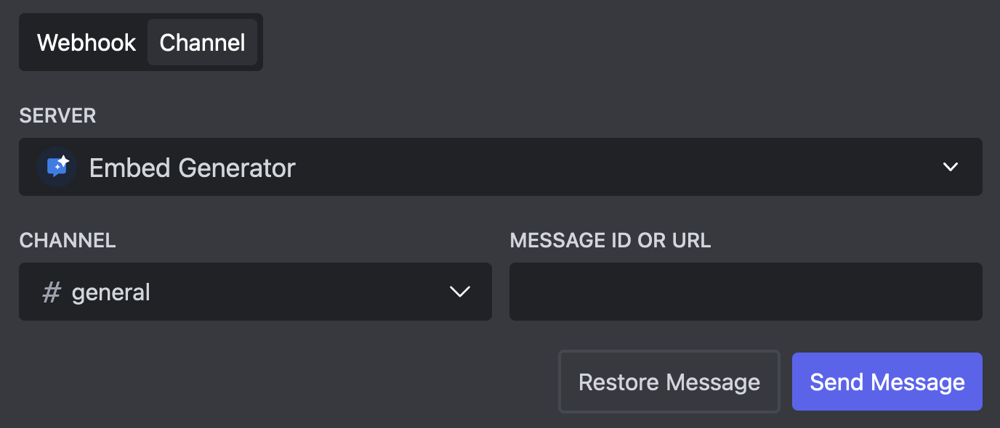
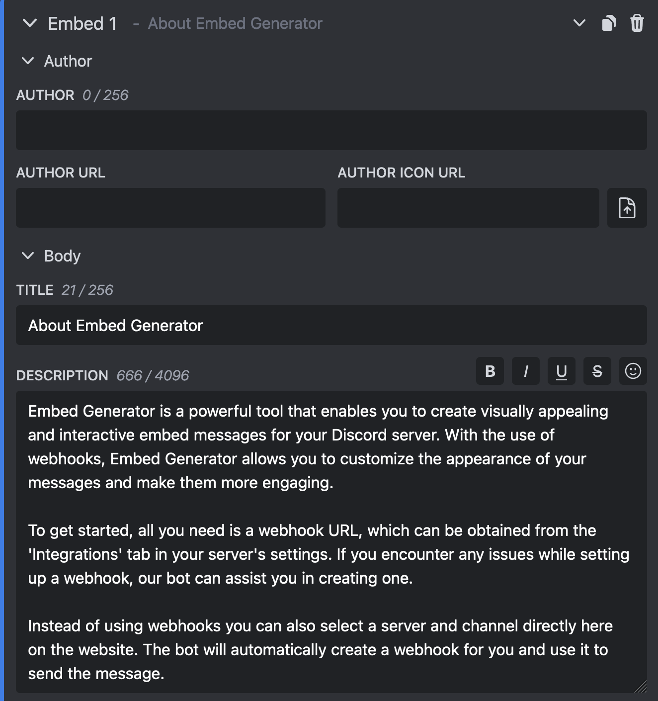

Embed Generator and Discohook are both free, open source editors for Discord messages. You design a message in the browser, watch a live preview, and send it through a webhook or a bot. We build Embed Generator, so keep that in mind while reading. We checked every claim about Discohook against its current version.

TLDR: Both send webhook messages without an account. Pick Embed Generator if you want role buttons, recurring schedules, custom slash commands or an AI assistant, all set up on one website. Pick Discohook if you need welcome messages or roles on emoji reactions. Already using Discohook? Embed Generator opens your messages as they are.

<!--truncate-->

Discohook was rewritten from scratch in 2024 under a new maintainer. Older comparisons, including an earlier version of this post, describe the original site and are out of date.

## Why pick Embed Generator

**Send to a channel without a webhook URL.** Webhook mode works like Discohook: paste the URL and send, without logging in. In Channel mode you log in, pick a server and channel, and the Embed Generator bot sends the message with the name and avatar you set. See [Webhook or Channel?](/docs/guides/send-modes)

**Role buttons set up on the website.** Add a button or select menu and pick what it does: add, remove or toggle roles, reply with text, or reply with a saved message. Replies can use [variables](/docs/guides/variables) like the member's name. You never configure anything through commands in Discord.

**Scheduled messages with a calendar.** Sending once at a set time is free. With Premium a message can repeat every few hours, days, weeks or months, or go out on a list of dates. A calendar shows what's coming up. See [scheduled messages](/docs/guides/scheduled-messages).

**Custom slash commands and your own bot.** With Premium you can add [slash commands](/docs/guides/custom-commands) that reply with your messages, and [connect your own bot](/docs/guides/custom-bots) so replies carry its name and avatar.

**An AI assistant.** Describe the message you want and the [AI assistant](/docs/features/ai-assistant) builds it in the editor. Every server gets a few free prompts each month.

**Embeds from inside Discord.** The `/embed` command builds an embed message right in Discord, without opening the website.

## When Discohook is the better pick

Discohook can post a message when someone joins or leaves the server. Embed Generator can't, because its bot doesn't receive member events. Discohook can also hand out roles when members react with an emoji. Embed Generator does roles with buttons and select menus only.

Discohook's flows can check conditions and wait between steps, which helps with multi-step logic.

Discohook has no paid plan. In Embed Generator the editor, webhooks, role buttons and one-time schedules are free. Recurring schedules, custom commands and replies from your own bot need [Premium](/docs/premium), $4.99 a month per server.

## Side by side

|                                       | Embed Generator                     | Discohook                    |
| ------------------------------------- | ----------------------------------- | ---------------------------- |
| Send through a webhook without login  | Yes                                 | Yes                          |
| Self-assignable roles                 | Buttons and select menus            | Buttons, select menus, emoji reactions |
| Scheduled messages                    | Once for free, recurring or on a list of dates with Premium, calendar view | Yes, also recurring |
| Components V2                         | Yes                                 | Yes                          |
| Custom slash commands                 | Premium                             | No                           |
| AI assistant                          | Yes                                 | No                           |
| Create embeds with a Discord command  | Yes, `/embed`                       | No                           |
| Welcome and goodbye messages          | No                                  | Yes                          |
| Price                                 | Free, Premium $4.99/month/server    | Free, optional donor perks   |

## Switching from Discohook

You don't have to rebuild anything:

- **One message:** copy its JSON from Discohook and paste it into the [JSON editor](https://message.style/app/editor/json).
- **All backups:** export them in Discohook and import the file under [saved messages](https://message.style/app/messages). The [migration guide](/docs/guides/migrating-discohook) walks through it.
- **Message links:** a Discohook link that carries the message in `?data=` opens here too. Replace `discohook.app` with `message.style`.

[Open the editor](https://message.style/app/editor)
