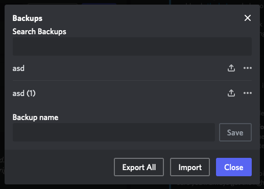
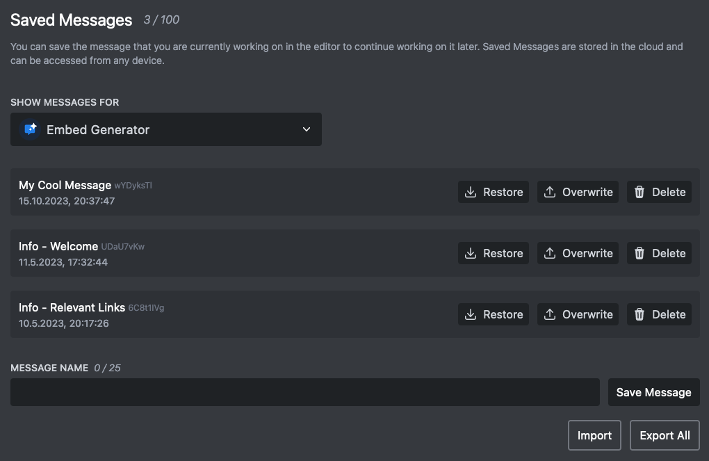

# Migrating from Discohook

If you are coming from Discohook and would like to start using Embed Generator instead you are right here. With a few simple steps you can migrate your message backups and get started with Embed Generator.

## Getting started

To get started with Embed Generator go [message.style/app](https://message.style/app/editor). You will see a message editor that should look fairly similar to what you are used to from Discohook. Building and sending messages works much the same way.

You can send through a webhook without logging in, just like on Discohook. To save messages, or to send to a channel without copying a webhook URL, log in with your Discord account. Your saved messages are stored in the cloud so you can open them on any device. For how the two compare, see [Embed Generator vs Discohook](/blog/discohook-alternative).

## Migrating your messages

Migrating your message backups from Discohook to Embed Generator is very easy and only requires a few clicks. Just open up the message backups list on Discohook and click on "Export All":

The open up the [saved messages](https://message.style/app/messages) on Embed Generator. You first have to login with your Discord account so your saved messages can be stored securely in the cloud. You can choose between saving messages associated with your Discord account or with a Discord server you are in. Messages associated with a Discord server can be accessed by all members of that server that have the necessary permissions.

To import your messages from Discohook click on "Import" and select the file that you got from Discohook.

That's it, your messages should be there!
